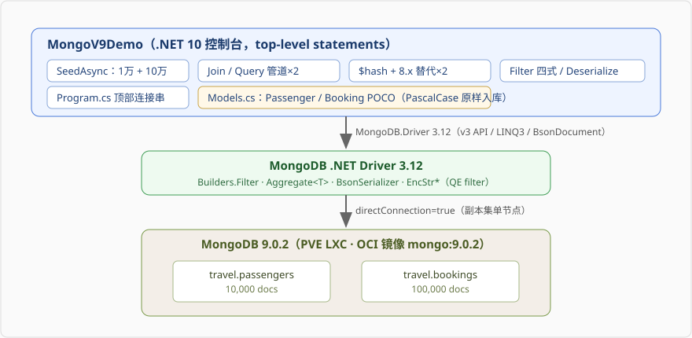

# MongoV9Demo

MongoDB 9 新特性学习演示：单个 .NET 10 控制台程序，连接本地 MongoDB 9.0.2 容器，覆盖 join 聚合、服务端哈希、filter 创建方式、BSON 反序列化、聚合管道的两种构建风格，以及 Queryable Encryption 前缀/后缀 filter。


交互版架构图：[在线打开](https://fangqiank.github.io/MongoV9Demo/mongo9demo-architecture.html)（可点节点、追路径、查看源码定位；离线版在本仓库 mongo9demo-architecture.html）

## MongoDB 9.0 新特性总结

依据[官方 9.0 发布说明](https://www.mongodb.com/docs/manual/release-notes/9.0/)：

| 特性 | 说明 |
|---|---|
| **Queryable Encryption 前缀/后缀/子串查询 GA** | 加密字符串字段可按前缀/后缀/子串检索（`$encStrStartsWith` / `$encStrEndsWith` / `$encStrContains`），无需解密；`mongocryptd` 弃用，改用 Automatic Encryption Shared Library |
| **单查询内存上限** | 单个查询上限 1 GB 或进程内存 20%（取大者），超出直接报错，不再无限占用 |
| **查询级 query settings** | `find` / `distinct` / `aggregate` 可直接携带 `querySettings` 字段，单次执行生效；另有 `queryKnobs` 调优与按查询形状的 `maxTimeMS` |
| **服务端 JS 反弃用（WASM）** | `$accumulator` / `$function` / `$where` 回归，迁移到基于 WebAssembly 的沙箱 JS 引擎 |
| **Time series 重构** | 存储为单一命名空间的压缩桶，支持 `renameCollection` |
| **约束校验（constraint）** | 校验规则保证**所有**文档满足，不只校验新写入 |
| **BSON 校验强制开启** | `--objcheck` 弃用，非法 BSON 默认直接报错 |
| **多文档事务并发上限** | 默认 `10000`，超出拒绝并报 `TooManyOpenTransactions` |
| **`$queryStats` 增强** | 输出结构化重构；覆盖写操作；默认开启（读/写各 1% 采样） |

> 版本注记：`$hash`（SHA-256）聚合操作符实为 **8.3** 引入（[手册](https://www.mongodb.com/docs/manual/reference/operator/aggregation/hash/)），常被误传为 9.0 新增；`$lookup` 管道语法 8.x 与 9.0 完全一致，性能优化来自服务端执行引擎的逐版本改进。

## 演示内容

| Demo | 内容 | 最低服务器版本 |
|---|---|---|
| `DemoJoinAsync` | `$lookup` join 管道（`BsonDocument` 字面量构建） | 任意 |
| `Query.Create()` | 整条管道 JSON 字符串 + `Deserialize<BsonDocument[]>` | 任意 |
| `DemoHashAsync` A | `$hash` SHA-256 | 8.3+ |
| `DemoHashAsync` B | 8.x 替代：`$toHashedIndexKey`（MD5 哈希索引算法） | 5.0+ |
| `DemoHashAsync` C | 8.x 替代：`$function` JS（服务端沙箱无 crypto，SHA-256 不可行） | 3.4.3+ |
| `DemoFiltersAsync` ①–⑤ | filter 四种创建方式：Builders / lambda / JSON 字符串 / BsonDocument | 任意（驱动侧） |
| `DemoFiltersAsync` ⑥ | QE 前缀/后缀 filter 构建（执行需 KMS + encryptedFields） | 9.0（执行） |
| `DemoDeserializeAsync` | `BsonSerializer.Deserialize`：BsonDocument / JSON → POCO | 任意（驱动侧） |

## 快速开始

```powershell
dotnet run --project MongoV9Demo
```

前置：

- .NET 10 SDK
- MongoDB 9.0.2 实例（本地容器即可；PVE 可用 `pct create <id> docker.io/library/mongo:9.0.2 --ostype oci ...` 直接以 OCI 镜像建 LXC）
- 修改 `Program.cs` 顶部的连接串指向你的实例。副本集模式单节点建议带 `?directConnection=true`（成员注册的是容器内部主机名时，不带会被重定向到解析不了的地址）

首次运行自动 seed：1 万 passengers + 10 万 bookings（`travel` 库，幂等，两个集合各自判空补种）。

## 示例输出（9.0.2 实测）

```text
MongoDB 版本: 9.0.2
=== Join 聚合 ===            返回 5 条，耗时 12 ms
=== 哈希 ===                 A $hash: P000000007012 -> Binary:0x35428bad...（SHA-256）
                             B $toHashedIndexKey: ... -> -5083898849668737242
=== Filter 创建方式 ===      ① Builders+&: 1 条 … ⑤ In: 3747 条
=== BsonSerializer ===       ③ 未映射字段默认报错: Element 'Extra' does not match …
```
